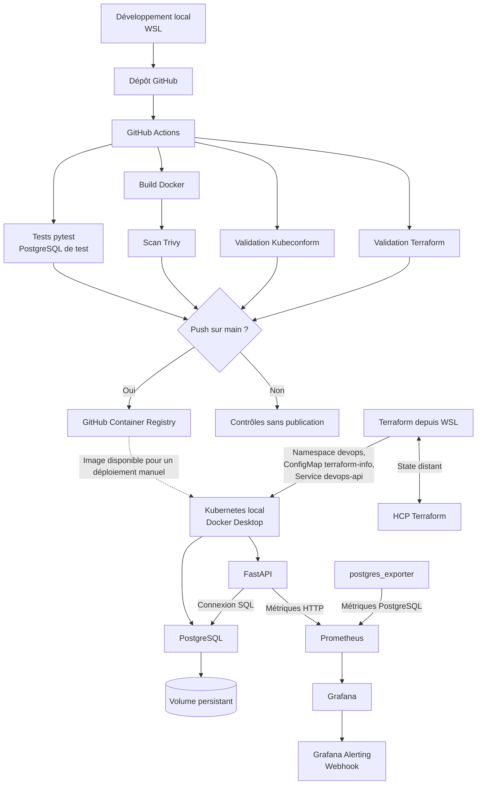
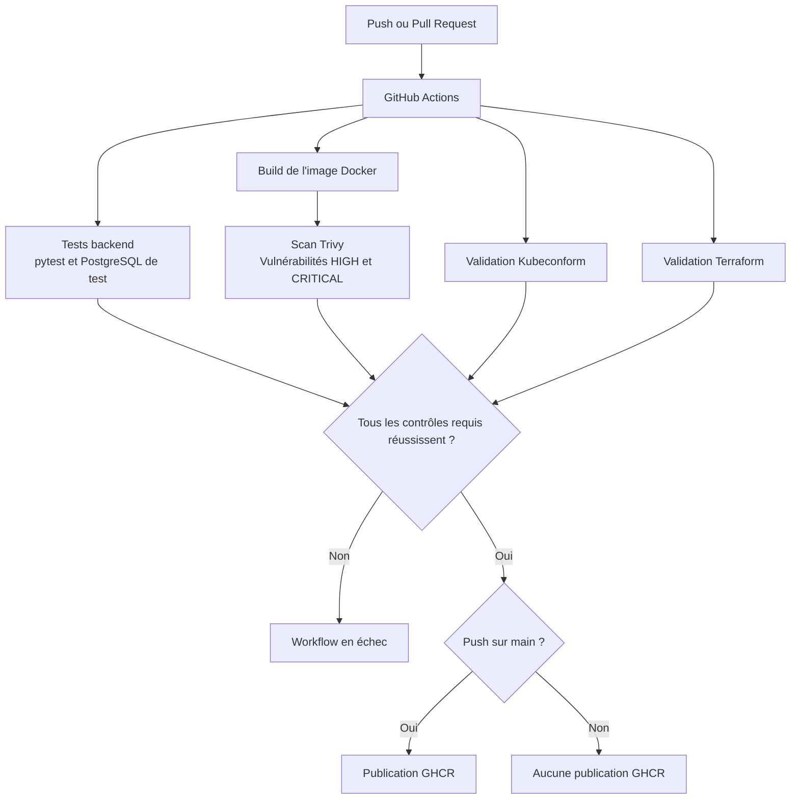
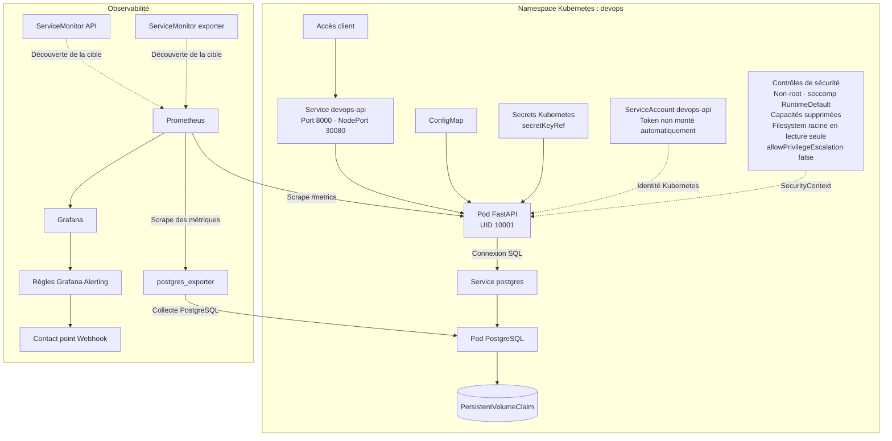

# Diagrammes d’architecture — DevOps Deploy Platform

Ce document présente trois vues complémentaires de la plateforme :
l'architecture générale, le pipeline CI/CD et le runtime Kubernetes
avec ses composants de supervision.

Les diagrammes utilisent Mermaid afin de rester modifiables et versionnés
avec le code source. Ils peuvent être visualisés dans l'aperçu Markdown
de VS Code et directement sur GitHub.

---

## 1. Architecture générale

Cette vue présente le parcours du code jusqu'à l'application déployée,
ainsi que les composants Terraform et la supervision.

**À retenir :**

- Les Pull Requests exécutent les contrôles sans publier d'image sur GHCR.
- La publication sur GHCR est conditionnée à un push sur main.
- Le déploiement Kubernetes est réalisé manuellement avec kubectl.
- Terraform est exécuté depuis WSL et utilise HCP Terraform pour conserver son state distant.

---

## 2. Pipeline CI/CD

Ce diagramme détaille les principales étapes du workflow GitHub Actions.

**Règles du pipeline :**

- Les Pull Requests exécutent les contrôles sans publier d'image.
- Les pushes sur `main` peuvent publier l'image après les contrôles requis.
- Kubeconform valide les manifests sans nécessiter un accès au cluster local.
- Terraform valide la configuration dans la CI ; le workflow ne déploie pas les ressources Terraform dans le cluster.

---

## 3. Runtime Kubernetes et observabilité

Cette vue décrit les composants de l'application, les contrôles de sécurité
et la collecte des métriques.

**Contrôles de sécurité représentés :**

- L'API tourne sans privilèges root, avec l'UID `10001`.
- Le token du `ServiceAccount` n'est pas monté automatiquement.
- Le système de fichiers racine est en lecture seule.
- Les capacités Linux sont supprimées et l'escalade de privilèges est désactivée.
- PostgreSQL conserve ses données sur un volume persistant.
- Prometheus collecte les métriques des cibles configurées et Grafana les présente.